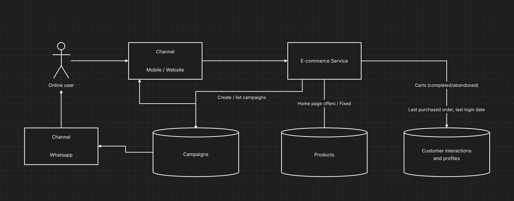
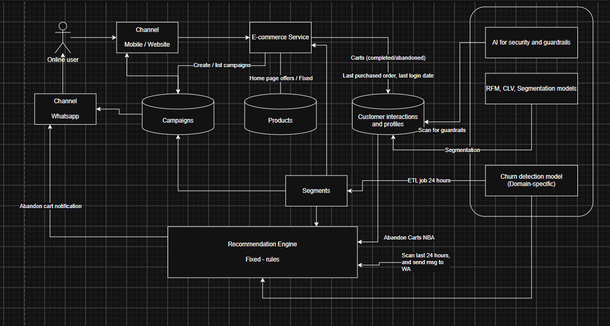

# 01: Framing the Problem

> Session 1: Architecture Views, Steps and Process.
> Fill each section in your own words. The comments are prompts; delete them when done.

## 1. Problem statement
<!-- What hurts today, for whom, and how do we know? -->

## 2. Goals and non-goals
<!-- Goals: measurable, each with a baseline and a target (e.g. "CSAT 70% → 80%").
     Non-goals: what we deliberately will NOT do in this phase. -->

| Goal | Baseline | Target | How we measure / attribute |
|---|---|---|---|
| | | | |

**Non-goals:**
-

## 3. As-is architecture

<!-- 3–5 bullets: current systems, data flows, pain points. -->

## 4. Architecture principles
<!-- 5 principles, each linked to a business goal (this is also Mini Project 1). -->

See [Mini Project 1: Governance Pack](mini-project-1-governance.md) for the full table.

| # | Principle | Why (business goal) |
|---|---|---|
| P1 | Customer data stays in-country | Compliance (PDPL) |
| P2 | Guardrails on every customer-facing AI output | Trust, CSAT 60% → 80% |
| P3 | Baseline, target and A/B test per use case | Prove the CSAT goal |
| P4 | Human approval for agent actions reaching customers | Reduce risk |
| P5 | Freshness matched to need | Control cost |

## 5. To-be architecture

<!-- What changes vs. as-is, and why. -->

## 6. Views and perspectives
<!-- Which views you used (context, container, deployment, data…) and how
     security / compliance / performance apply to each. -->

## 7. Use cases
### 7.1 Homepage personalisation
### 7.2 Next-best action / abandoned cart
### 7.3 Churn prediction
### 7.4 Cold start
### 7.5 Agentic campaign automation
<!-- For each: trigger, data needed, freshness (real-time / near-real-time / batch), success metric. -->

## 8. Decisions
- [ADR-0001: Abandoned-cart detection with a 15-minute batch job](../adr/0001-abandoned-cart-detection.md)
- [ADR-0002: Route campaign LLM calls by data classification](../adr/0002-llm-hosting-for-campaigns.md)
- [ADR-0003: Inline safety check on agent messages](../adr/0003-agent-message-safety-check.md)
- [ADR-0004: Precomputed top-K for "Frequently bought together"](../adr/0004-fbt-precomputed-top-k.md)
