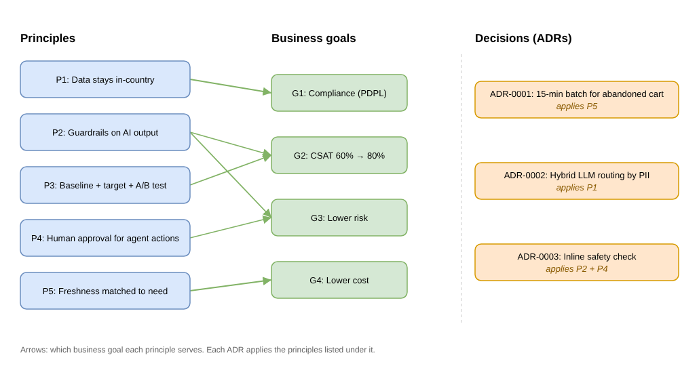

# Mini Project 1: Governance Pack

> Marketing Automation with AI & Agents for an e-commerce company in Saudi Arabia.
> Business goal: raise CSAT from **60% to 80%** (measured by customer ratings and text feedback).

## 1. Architecture principles

| # | Principle | Business goal it serves | In practice |
|---|---|---|---|
| P1 | **Customer data stays in-country**, at rest and in transit | Compliance (PDPL), avoid fines and shutdown | All storage, processing, DR and LLM calls with personal data run inside Saudi Arabia ([ADR-0002](../adr/0002-llm-hosting-for-campaigns.md)) |
| P2 | **Every customer-facing AI output passes guardrails** before it reaches the customer | Customer trust, CSAT 60% → 80% | Filters for toxicity, wrong offers, PII leaks and prompt injection ([ADR-0003](../adr/0003-agent-message-safety-check.md)) |
| P3 | **Every use case has a baseline, a target and an A/B test** before launch | Prove the CSAT goal is reached and caused by the system | No launch without a written metric and a control group |
| P4 | **Agent actions that reach customers need human approval** | Reduce business and brand risk | Campaigns created by the agent wait for a marketer to approve |
| P5 | **Freshness is matched to need**: real-time only where it pays off | Control infrastructure cost | Each use case declares real-time / near-real-time / batch with a reason ([ADR-0001](../adr/0001-abandoned-cart-detection.md)) |

## 2. Key decisions (ADRs)

| ADR | Decision | Why |
|---|---|---|
| [0001](../adr/0001-abandoned-cart-detection.md) | Abandoned carts detected by a **batch job every 15 min**, not streaming | Cheapest; gives the customer time to finish browsing before we remind them |
| [0002](../adr/0002-llm-hosting-for-campaigns.md) | **Hybrid LLM routing** by data classification: external API without PII, self-hosted model with PII | Best quality where allowed, PDPL compliance where needed; fail-safe to self-hosted |
| [0003](../adr/0003-agent-message-safety-check.md) | Safety check on agent messages runs **inline** | A few seconds don't matter for campaigns; a bad message to customers costs a lot |

## 3. ARB checklist

Before any use case goes live, it passes the [ARB checklist](arb-checklist.md):
business metric and A/B plan, in-country data and PII handling, guardrails and human approval,
security sign-off, SLOs load-tested, observability, DR, cost, and an ADR for every major decision.
