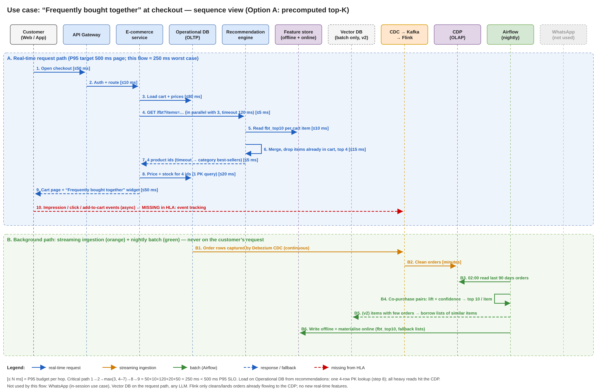

# Mini Project 2: Use-Case Flow View — "Frequently bought together" at checkout

> Same running system: Marketing Automation with AI & Agents, e-commerce in Saudi Arabia.
> Inspired by Amazon's "Frequently bought together" and Noon's cart add-ons.
> SLO from the SDD: P95 500 ms, P50 < 100 ms, 1000 RPS.

Source: [`diagrams/03-fbt-checkout-flow.drawio`](../diagrams/03-fbt-checkout-flow.drawio)

**Use case.** A customer opens the cart/checkout with a phone in the basket. We show 4 items that
other customers often buy *with* it (case, charger, screen protector) to raise basket size and CSAT.

## 1. Two paths

- **Real-time (A, steps 1–9):** E-commerce service asks the recommender *in parallel* with loading the cart.
  The recommender only reads a precomputed list per cart item from the online feature store, merges,
  drops items already in the cart, returns top 4. E-commerce checks price and stock with one PK query.
- **Background (B1–B6):** Orders flow Ops DB → Debezium CDC → Kafka → Flink → CDP. Every night Airflow reads
  90 days of orders from the **CDP** (not the Ops DB), computes co-purchase pairs (lift + confidence),
  and writes `fbt_top10` per item plus fallback lists to the feature store.

## 2. Options compared

| | **A. Precomputed top-K (chosen)** | B. Vector DB query per request | C. Co-purchase SQL on Ops DB |
|---|---|---|---|
| Latency (P95) | ~10–30 ms (key lookup) | ~80–150 ms (embed + ANN + rank) | 200 ms – seconds (joins on orders) |
| Cost | Low: one nightly job + Redis | High: vector DB and embedding compute sized for 1000 RPS | Low infra, but DB must be scaled up |
| Ops DB load | ~0 (one 4-row PK lookup) | ~0 | **Very high**, hurts checkout itself |
| Quality | Real complements ("bought with") | Similar items = **substitutes** (another phone), wrong for this widget | Good, but the extra freshness adds little value |

**Decision: A** ([ADR-0004](../adr/0004-fbt-precomputed-top-k.md)). "Bought together" changes slowly, so a nightly
list is fresh enough; it is the fastest, cheapest and keeps the Ops DB safe. Fallback on timeout: category best-sellers.

## 3. Over-engineering check (vs. the high-level view)

- **Needed:** Channels, API Gateway, E-commerce service, Ops DB (source + stock check), CDC→Kafka→Flink (already feeds the CDP), CDP, Airflow, Feature store (online), Recommendation engine.
- **Not needed:** WhatsApp (in-session use case), Vector DB on the request path, any LLM, a new Flink real-time feature. Vector DB only later (v2) in batch for new items with few orders.
- **Missing from the HLA:** an **event-tracking collector** for widget impressions/clicks/add-to-cart (step 10).
  Without it we cannot run the A/B test required by principle P3 or measure uplift.

## 4. Latency budget (P95)

| Hop | 1 Client→GW | 2 GW→Ecom | 3 Cart load | 4–7 Recommender (parallel, timeout) | 8 Stock/price | 9 Response | **Total** |
|---|---|---|---|---|---|---|---|
| ms | 50 | 10 | 80 | 120 max (expected ~35) | 20 | 50 | **≈250 < 500** |
